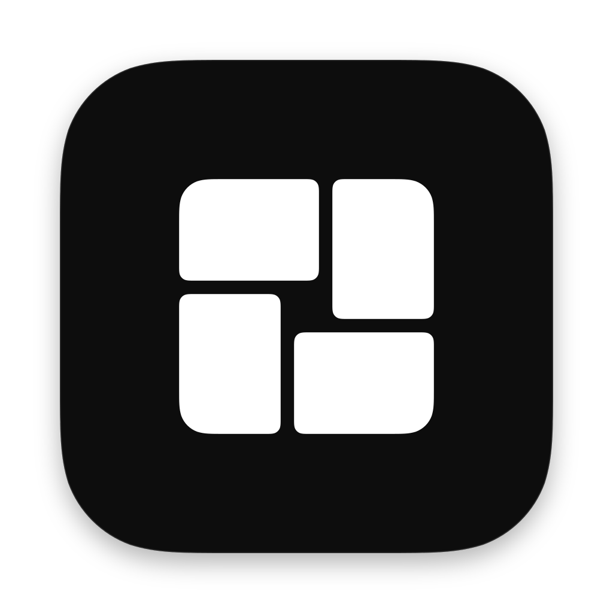

[English](README.md) · **Português (Brasil)**

<p align="center">
  
</p>

<h1 align="center">WinHub</h1>

<p align="center">
  <b>Encontre, instale e abra programas e jogos do Windows no Mac, como qualquer outro app.</b>
</p>

<p align="center">
  <a href="https://github.com/AngeloResplandes/winhub/releases/latest/download/WinHub.zip">Baixar</a> ·
  <a href="https://angeloresplandes.github.io/winhub/pt-BR/">Documentação</a> ·
  <a href="ROADMAP.pt-BR.md">Roadmap</a> ·
  <a href="docs/pt-BR/reverse-engineering.md">Como o CrossOver foi estudado</a> ·
  <a href="docs/pt-BR/crossover-parity.md">Paridade com o CrossOver</a>
</p>

O WinHub é um app nativo para macOS que cuida de tudo o que o [Wine](https://www.winehq.org/) precisa para rodar
programas do Windows, sem máquina virtual e sem instalar o Windows. Encontre um título no catálogo e instale;
títulos com receita, como a Steam, instalam com um clique. Cada programa fica numa "garrafa", um Windows separado
com as próprias configurações, e os programas instalados ganham atalhos que abrem pelo Finder, pelo Spotlight ou
pelo Dock.

O WinHub foi desenhado estudando **como o CrossOver 26.3 se comporta** (a busca do catálogo, as garrafas, como ele
escolhe o Direct3D de cada jogo) e reproduzindo esse comportamento com código aberto. O motor dele, o
[winhub-engine](https://github.com/AngeloResplandes/winhub-engine), é o Wine 11 compilado das fontes que a
CodeWeavers publica sob a LGPL, com DXMT, DXVK e um módulo aberto que escolhe o Direct3D de cada processo. Nenhum
código ou dado fechado do CrossOver é usado.

## Recursos

| | |
|---|---|
| **Catálogo com busca** | palavras em ordem, sem diferenciar maiúsculas e acentos, nomes no seu idioma; as mesmas regras da busca do CrossOver |
| **Receitas com um clique** | a Steam instala e abre com um clique; jogos da Steam ganham "Jogar pela Steam" |
| **Qualquer instalador** | escolha um `.exe` ou `.msi` e a garrafa (⌘I) |
| **Garrafas** | cada uma com versão do Windows, Direct3D, msync, painel de desempenho e componentes do winetricks |
| **Direct3D por garrafa ou por jogo** | Automático, Wine, DXMT (Metal), DXVK (Vulkan) ou o seu D3DMetal ([Gráficos](docs/pt-BR/graphics.md)) |
| **Steam que funciona** | um pequeno wrapper corrige a janela preta da Steam no Wine 11 para macOS |
| **Atalhos** | `~/Applications/WinHub/<garrafa>/<programa>.app`, para o Finder, o Spotlight e o Dock |
| **Atualiza-se sozinho** | app, catálogo, lista de motores e regras por jogo assinadas, tudo conferido antes de usar |

## Estado

| | |
|---|---|
| Versão | 0.2 (uma versão a cada push na `main`) |
| Paridade com o CrossOver | **~57%** (estimado, [detalhes](docs/pt-BR/crossover-parity.md)) |
| Testado | Steam com login salvo; Hollow Knight (Direct3D 11) a 60 FPS pelo DXMT ([relatórios](docs/pt-BR/compat/README.md)) |
| Maiores lacunas | Direct3D 12 sem D3DMetal, catálogo pequeno, banco de regras vazio ([todas as lacunas](docs/pt-BR/gaps.md)) |

### Limitações conhecidas

- O **D3DMetal** (Game Porting Toolkit da Apple) não vem junto: a licença da Apple não permite redistribuí-lo. Se
  você o tem, aponte **Ajustes → D3DMetal** para ele.
- O Direct3D do próprio Wine só chega ao feature level 9_3 no macOS; jogos Direct3D 11 precisam de DXMT, DXVK ou
  D3DMetal.
- Os jogos veem os modos de tela da própria tela do Mac; **Resoluções extras** acrescenta 16:9 e outros até o tamanho
  da tela em pontos, então o 1920×1080 ainda falta na maioria dos Macs.
- O motor é x86_64: Macs com Apple silicon precisam do **Rosetta 2**, que a Apple mantém de forma geral até o
  macOS 27.
- A interface é em português do Brasil e em inglês (segue o idioma do macOS).

## Instalar

1. Baixe o [`WinHub.zip` da versão mais recente](https://github.com/AngeloResplandes/winhub/releases/latest/download/WinHub.zip)
   e mova o `WinHub.app` para Aplicativos.
2. Se o app não estiver notarizado, o macOS bloqueia a primeira abertura. Tente abrir uma vez e, em **Ajustes do
   Sistema → Privacidade e Segurança**, clique em **Abrir Mesmo Assim** (desde o macOS 15, o clique direito →
   Abrir não basta mais).
3. No WinHub, clique em **Baixar o Wine** (cerca de 190 MB, uma vez só).

Depois disso o WinHub se atualiza sozinho: o catálogo acompanha este repositório, e as versões novas do app são
baixadas em segundo plano e instaladas quando você clica em **Reiniciar para atualizar** (desligue em
**Ajustes → Atualizações**).

## Compilação

macOS 14+, Xcode 16+ (Swift 6), Rosetta 2 em Apple silicon.

```bash
swift build && swift test
```

```bash
swift run WinHub
```

Empacotamento, Steam com `swift run`, testes com o Wine de verdade e como testar um motor local:
[Desenvolvimento](docs/pt-BR/development.md).

## Documentação

A documentação completa é um livro, em inglês e português do Brasil:
**[angeloresplandes.github.io/winhub/pt-BR](https://angeloresplandes.github.io/winhub/pt-BR/)** (fontes em
[`docs/pt-BR/`](docs/pt-BR/)).

## Regras

- O CrossOver foi estudado só pelo comportamento; o código, os dados, o catálogo e a interface dele nunca são
  copiados. Veja [Engenharia reversa](docs/pt-BR/reverse-engineering.md) e [CONTRIBUTING](CONTRIBUTING.pt-BR.md).
- Nada de binários de terceiros no repositório: o Wine, os componentes e os instaladores são baixados das fontes
  oficiais e conferidos por SHA-256.
- O D3DMetal da Apple nunca é redistribuído.

## Licença

MIT ([LICENSE](LICENSE)). Componentes de terceiros: [THIRD_PARTY_NOTICES](THIRD_PARTY_NOTICES.pt-BR.md).

---

**Projeto independente.** Sem vínculo com a CodeWeavers, a Apple, a Microsoft ou a Valve. CrossOver é marca da
CodeWeavers; o nome é usado só para dizer o que foi estudado e de onde vêm as fontes do Wine do motor.
